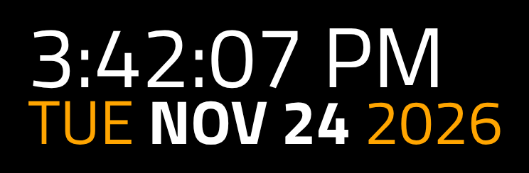

# MMM-Glock

A simple 12-hour clock for [MagicMirror²](https://github.com/MagicMirrorOrg/MagicMirror), with the date shown underneath.



- Time in 12-hour format, with or without seconds
- Date line with the day and year in your accent color and the month and day number in bold white
- Font (Titillium Web) is bundled with the module, so it works without an internet connection
- No extra dependencies and no `npm install` needed

## Installation

```bash
cd ~/MagicMirror/modules
git clone https://github.com/cowboysdude/MMM-Glock
```

## Updating

```bash
cd ~/MagicMirror/modules/MMM-Glock
git pull
```

## Configuration

Add this to the `modules` array in `~/MagicMirror/config/config.js`:

```js
{
	module: "MMM-Glock",
	position: "top_center",
	config: {
		color: "white",   // clock color
		size: "1.0em",    // overall size
		sec: true,        // show seconds
		dcolor: "orange", // date color
		showDate: true    // show the date line
	}
},
```

### Options

| Option     | Default    | Description |
|------------|------------|-------------|
| `color`    | `"white"`  | Color of the time. Any CSS color works (`"white"`, `"#ff9900"`, `"rgb(0,200,255)"`). |
| `size`     | `"1.0em"`  | Overall size of the clock. Scales the time and the date together; try `"1.5em"` or `"0.8em"`. |
| `sec`      | `false`    | `true` shows seconds (`3:42:07 PM`); `false` shows `3:42 PM`. |
| `dcolor`   | `"orange"` | Color of the weekday and year on the date line. The month and day number stay bold white. |
| `showDate` | `true`     | `false` hides the date line and shows only the time. |

The clock can go in any MagicMirror position (`top_left`, `top_center`, `middle_center`, `bottom_bar` and so on), and its colors and size only affect this module.

## Credits

- Font: [Titillium Web](https://fonts.google.com/specimen/Titillium+Web), licensed under the SIL Open Font License 1.1 (see `fonts/OFL.txt`).
